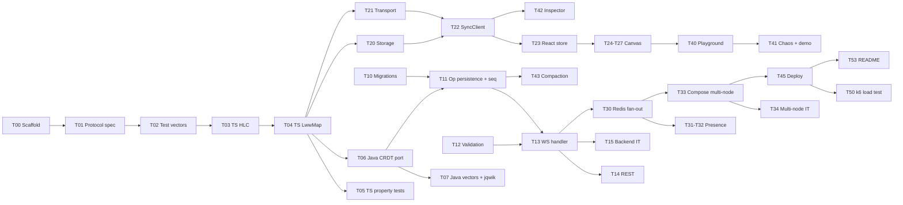

# SyncCanvas — Implementation Plan (Agent-Delegable)

Companion to `PRD.md` v1.1. Every task below is sized for **one agent session** (≈1–4 hours of agent work) and is self-contained: it lists its inputs, the files it owns, its dependencies, and acceptance criteria that can be checked by running commands.

---

## 0. How to Use This Plan

### 0.1 Ownership tags

| Tag | Meaning | Why |
| --- | --- | --- |
| 🧠 **YOU** | Write the implementation yourself. An agent may write the **tests** and review your code. | This is the core you will be questioned on in interviews (HLC, merge, sequencing, sync protocol). |
| 🤝 **AGENT + REVIEW** | An agent implements it; you review **every line** and must be able to explain it. | Important but mechanical, e.g. the Java port of your TS core. |
| 🤖 **AGENT** | Delegate fully; skim the diff and run it. | UI, boilerplate, infrastructure, docs. |

### 0.2 Prompt template for delegating a task

```text
You are working on the SyncCanvas repo. First read AGENTS.md, PRD.md, and
IMPLEMENTATION_PLAN.md §2 (Shared Contracts). Then complete task <ID> from
IMPLEMENTATION_PLAN.md exactly as specified. Only modify files listed under
"Owns". When done, run the verification commands in the task and report:
files changed, verification output, and any deviations or open questions.
Do not modify spec/ or files marked @human-owned.
```

### 0.3 Rules for running agents in parallel
- Only run tasks **in parallel** when they are in the same "Parallel lane" group and their **Owns** lists do not overlap.
- Merge to `main` only after the task's verification passes. Rebase the other open branches after each merge.
- Each week ends with a **Gate**: a checklist you run yourself before starting the next week.

### 0.4 Dependency overview



---

## 1. Week-by-Week Summary

| Week | Goal | Tasks | Parallel lanes | Gate |
| --- | --- | --- | --- | --- |
| 1 | CRDT core proven identical in TS and Java | T00–T08 | {T05, T06, T08} after T04 | G1 |
| 2 | Single-node backend persists and broadcasts ops | T10–T15 | {T10, T12} → T11 → T13 → {T14, T15} | G2 |
| 3 | Canvas works offline and syncs to the backend | T20–T27 | {T20, T21} → T22 → T23 → {T24, T25, T26, T27} | G3 |
| 4 | Multi-node + presence | T30–T34 | T30 → {T31, T32, T33} → T34 | G4 |
| 5 | Recruiter playground live on the internet | T40–T45 | {T40, T42, T43, T44} → T41; T45 | G5 |
| 6 | Numbers + story | T50–T54 | {T50, T51, T52, T53} → T54 | G6 |
| 7–8 | P1 polish | T60–T65 | all parallel | — |

---

## 2. Shared Contracts (freeze in Week 1 — every agent codes against these)

### 2.1 TypeScript (`packages/sync-engine/src/types.ts`)

```ts
export type HlcString = string; // "{13-digit ms}:{5-digit counter}:{nodeId}"

export interface Hlc { physicalTime: number; counter: number; nodeId: string; }

export type Point = [number, number];
export type FieldValue = string | number | boolean | null | Point[];

export interface Op {
  objectId: string;
  field: string;
  value: FieldValue;
  hlc: HlcString;
}

export interface Register { value: FieldValue; hlc: HlcString; }

export type MergeResult =
  | { status: "ACCEPTED"; previous?: Register }
  | { status: "DISCARDED_STALE"; current: Register; reason: string };

// ---- Clock ----
export interface HlcClock {
  tick(): HlcString;                 // local event
  receive(remote: HlcString): void;  // remote event (throws ClockSkewError if > now + maxDriftMs)
  last(): HlcString;
}
// factory: createHlcClock({ nodeId, now: () => number, maxDriftMs = 60_000, initial?: HlcString })
// helpers: parseHlc(s): Hlc; formatHlc(h): HlcString; compareHlc(a, b): -1 | 0 | 1

// ---- CRDT ----
export interface LwwMap {
  apply(op: Op): MergeResult;                 // pure merge, no I/O
  get(objectId: string, field: string): Register | undefined;
  getObject(objectId: string): Record<string, FieldValue> | undefined; // undefined if no `type` or deleted
  visibleObjectIds(): string[];               // sorted by (zIndex, objectId)
  entries(): Iterable<[objectId: string, field: string, reg: Register]>;
  stateHash(): Promise<string>;               // see 2.3
  toJSON(): SnapshotState;
}
export type SnapshotState = Record<string, Record<string, Register>>;

// ---- Storage ----
export interface Storage {
  load(): Promise<{ state: SnapshotState; outbox: Op[]; meta: Meta }>;
  putRegisters(ops: Op[]): Promise<void>;
  outboxPut(ops: Op[]): Promise<void>;        // coalesces by (objectId, field), keeps max hlc
  outboxRemove(hlcs: HlcString[]): Promise<void>;
  setMeta(patch: Partial<Meta>): Promise<void>;
  destroy(): Promise<void>;
}
export interface Meta { nodeId: string; lastSyncedSeq: number; lastHlc: HlcString | null; }

// ---- Transport ----
export type ConnStatus = "online" | "connecting" | "offline";
export interface Transport {
  connect(): void;
  close(): void;
  send(msg: ClientMessage): void;             // queued/dropped while offline per impl
  onMessage(cb: (msg: ServerMessage) => void): () => void;
  onStatus(cb: (s: ConnStatus) => void): () => void;
  setOnline(online: boolean): void;           // "Kill Network" switch
  setLatency(ms: number): void;               // symmetric artificial delay
}

// ---- SyncClient events (Inspector + UI subscribe to these) ----
export type SyncEvent =
  | { kind: "local_op"; op: Op }
  | { kind: "remote_op"; op: Op; seq: number; result: MergeResult }
  | { kind: "sent"; ops: Op[] }
  | { kind: "acked"; hlcs: HlcString[]; seq: number }
  | { kind: "gap_detected"; expected: number; got: number }
  | { kind: "snapshot_required"; oldestAvailableSeq: number }
  | { kind: "outbox"; depth: number }
  | { kind: "status"; status: ConnStatus }
  | { kind: "error"; code: string; message: string };

export interface SyncClient {
  start(): Promise<void>;                     // load storage → hydrate → connect → SYNC_PULL
  stop(): Promise<void>;
  mutate(changes: Array<Omit<Op, "hlc">>): Op[]; // stamps HLCs, applies locally, persists, enqueues
  readonly map: LwwMap;
  subscribeObject(objectId: string, cb: () => void): () => void;
  subscribeIds(cb: () => void): () => void;   // visible id list / order changed
  on(cb: (e: SyncEvent) => void): () => void;
  readonly transport: Transport;
}
// factory: createSyncClient({ boardId, nodeId, storage, transport, clock, flushIntervalMs = 40 })
```

`ClientMessage` / `ServerMessage` are discriminated unions that mirror PRD §5.2 one-to-one (`SYNC_PUSH`, `SYNC_PULL`, `PRESENCE`, `SYNC_BROADCAST`, `SNAPSHOT_REQUIRED`, `ERROR`). They are defined in `packages/sync-engine/src/protocol.ts`.

### 2.2 Java (`server/src/main/java/com/synccanvas/`)

```java
// crdt
public record Hlc(long physicalTime, int counter, String nodeId) implements Comparable<Hlc> {
  public static Hlc parse(String s); public String format();
}
public final class HlcClock { HlcClock(String nodeId, LongSupplier now, long maxDriftMs);
  public Hlc tick(); public void receive(Hlc remote) throws ClockSkewException; }
public record Op(String objectId, String field, JsonNode value, String hlc) {}
public record Register(JsonNode value, String hlc) {}
public sealed interface MergeResult permits Accepted, DiscardedStale {}
public final class LwwMap { MergeResult apply(Op op); Optional<Register> get(String o, String f);
  Map<String, Map<String, Register>> toState(); String stateHash(); static LwwMap fromState(...); }

// persistence
public interface OpLogRepository {
  /** Atomically: dedupe, reserve n per-board seqs, insert. Returns only the newly stored ops with their seqs. */
  List<SequencedOp> appendBatch(String boardId, String originClientId, List<Op> ops);
  List<SequencedOp> readSince(String boardId, long sinceSeq, int limit);
  long oldestAvailableSeq(String boardId);
}
public record SequencedOp(long serverSeq, Op op) {}

// pubsub
public interface BoardBus {   // local in-memory impl in Week 2, Redis impl in Week 4
  void publishOps(String boardId, SyncBroadcast msg);
  void publishPresence(String boardId, Presence msg);
  void subscribe(String boardId, BoardListener l); void unsubscribe(String boardId, BoardListener l);
}
```

### 2.3 State hash (must match across languages)
1. Collect every register as `[objectId, field, value, hlc]`.
2. Sort by `objectId`, then `field` (plain code-point order).
3. Serialize the array with **RFC 8785 JSON Canonicalization (JCS)**. In TS use the `canonicalize` npm package; in Java use `io.github.erdtman:java-json-canonicalization`. JCS removes number-formatting differences such as Java's `420.0` vs JS's `420`.
4. Hash = lowercase hex SHA-256 of the UTF-8 bytes.

---

## 3. Week 1 — CRDT & HLC Core

### T00 · Monorepo scaffold · 🤖 AGENT
- **Depends on:** —
- **Owns:** repo root config, `apps/web/**` (skeleton only), `packages/sync-engine/**` (skeleton only), `server/**` (skeleton only), `docker-compose.yml`, `.github/workflows/ci.yml`
- **Steps:**
  1. pnpm workspace (`pnpm-workspace.yaml`: `apps/*`, `packages/*`); root `package.json` scripts `lint`, `typecheck`, `test`, `dev`.
  2. `apps/web`: `create-next-app` (TS, App Router, Tailwind, ESLint, `src/` dir). Depends on `@synccanvas/sync-engine` via `workspace:*`; add `transpilePackages`.
  3. `packages/sync-engine`: TS library, Vitest, `tsconfig` strict, `src/index.ts` exporting nothing yet.
  4. `server`: Spring Initializr equivalent — Java 21, Gradle Kotlin DSL, deps: `web`, `websocket`, `jdbc`, `flyway`, `postgresql`, `data-redis`, `validation`, `actuator`, `testcontainers`, `jqwik`. `spring.threads.virtual.enabled=true`. Health endpoint `/actuator/health`.
  5. `docker-compose.yml` with `postgres:16` (db `synccanvas`) and `redis:7`, with healthchecks.
  6. CI: two jobs (Node: lint/typecheck/test; Java: `./gradlew check` with service containers).
  7. `.editorconfig`, Prettier, root `README.md` stub, `.gitignore`.
- **Acceptance:** `pnpm -r test` and `./gradlew check` pass on a clean clone; `pnpm --filter web dev` serves a page; `docker compose up -d` gives healthy containers; CI is green.

### T01 · Protocol spec · 🤝 AGENT + REVIEW
- **Depends on:** T00
- **Owns:** `spec/protocol.md`, `spec/schema/*.json`, `packages/sync-engine/src/protocol.ts`, `packages/sync-engine/src/types.ts`
- **Steps:**
  1. Transcribe PRD §3, §5, and §6.3 into `spec/protocol.md`: message types, the HLC string format, ID formats, and limits (64KB frame, 500 objects).
  2. **Field whitelist** per object type, as a table with columns field / type / required / constraints:
     - common: `type`(enum `rect|ellipse|arrow|freehand|text|diamond|sticky`), `x`,`y`(number), `zIndex`(string), `deleted`(bool), `stroke`(hex), `strokeWidth`(0.5–32), `opacity`(0–1)
     - rect/ellipse/diamond/sticky: `w`,`h`(>0), `fill`(hex | `"transparent"`)
     - arrow: `x2`,`y2`, `arrowHead`(`none|end|both`)
     - freehand: `points`(Point[], ≤ 2,000 points)
     - text/sticky: `text`(string ≤ 2,000 chars), `fontSize`(8–128)
  3. JSON Schemas for every message (`spec/schema/`).
  4. Copy §2.1 types into `types.ts` and `protocol.ts` (types only, no logic).
- **Acceptance:** `pnpm -r typecheck` passes; you have read and approved `protocol.md`.

### T02 · Golden test vectors · 🧠 YOU (an agent may draft; you verify every expected value by hand)
- **Depends on:** T01
- **Owns:** `spec/vectors/hlc.json`, `spec/vectors/merge.json`, `spec/vectors/README.md`
- **Format:**
  ```json
  // hlc.json
  [{ "name": "remote ahead resets to remote counter+1", "nodeId": "a",
     "initial": "0000000001000:00000:a",
     "steps": [
       { "op": "tick", "now": 1000, "expect": "0000000001000:00001:a" },
       { "op": "recv", "now": 1000, "remote": "0000000002000:00007:b", "expect": "0000000002000:00008:a" },
       { "op": "recv", "now": 999999999, "remote": "0000000005000:00000:b", "expectError": "CLOCK_SKEW" }
     ]}]
  // merge.json
  [{ "name": "concurrent move + recolor both survive",
     "ops": [ {"objectId":"obj_1","field":"x","value":10,"hlc":"..."}, ... ],
     "expectState": { "obj_1": { "x": {"value":10,"hlc":"..."} } },
     "expectHash": "<sha256>" }]
  ```
- **Required cases (≥ 25 total):** all 4 branches of the receive rule; tick with a clock that moves backwards; counter overflow at 99999; skew rejection; nodeId tie-break; same op applied twice (idempotent); ops in reversed order (commutative); delete vs. concurrent edit (delete-wins); undelete with a greater HLC; zIndex tie sorted by objectId; float vs. integer values; a `points` array value.
- **Acceptance:** every case has a comment explaining *why* the expected value is right. Fill in `expectHash` after T04 exists, using a one-off script.

### T03 · TypeScript HLC · 🧠 YOU
- **Depends on:** T02
- **Owns:** `packages/sync-engine/src/hlc.ts` (add `// @human-owned`), `packages/sync-engine/test/hlc.test.ts`
- **Spec:** PRD §3.1, contract §2.1.
- **Agent's part (tests only):** a Vitest suite that loads `spec/vectors/hlc.json` and replays it, plus a fast-check property: *any interleaving of tick/receive produces strictly increasing HLCs per node*.
- **Acceptance:** `pnpm --filter sync-engine test` passes all HLC vectors and properties.

### T04 · TypeScript LwwMap + state hash · 🧠 YOU
- **Depends on:** T03
- **Owns:** `packages/sync-engine/src/lww-map.ts` (`@human-owned`), `src/hash.ts`, `test/lww-map.test.ts`
- **Spec:** PRD §3.2–3.3, contract §2.1 + §2.3. `visibleObjectIds()` sorts by `(zIndex, objectId)` and excludes objects that have no `type` or have `deleted === true`.
- **Agent's part (tests only):** vector replay from `merge.json`, plus unit tests for `getObject` and `visibleObjectIds`.
- **Acceptance:** all merge vectors pass; then fill in `expectHash` in `merge.json`.

### T05 · TS convergence property tests (network simulator) · 🤖 AGENT
- **Depends on:** T04
- **Owns:** `packages/sync-engine/test/sim/**`
- **Steps:**
  1. Build `Simulator`: N replicas (each with its own `HlcClock` and `LwwMap`) and a fake clock with per-replica skew of ±5s.
  2. fast-check generates: random local mutations (create/move/recolor/delete/undelete/text) on random replicas; a message network that **duplicates, drops (with later retry), reorders, and partitions**.
  3. At the end, heal all partitions and deliver every op to every replica.
  4. Property: all `stateHash()` values are equal. Also check that no visible object is missing its `type`.
  5. Configure 5 replicas, ≥ 10,000 ops total across runs (`numRuns` × ops per run), with a seed printed on failure.
- **Acceptance:** `pnpm --filter sync-engine test -- sim` passes; a deliberately broken merge (e.g., `>=` instead of `>`) makes it fail. Show this by temporarily patching it in a test-only fixture.

### T06 · Java CRDT port · 🤝 AGENT + REVIEW
- **Depends on:** T04
- **Owns:** `server/src/main/java/com/synccanvas/crdt/**`
- **Steps:** Port `hlc.ts` and `lww-map.ts` exactly, following contract §2.2. Use Jackson `JsonNode` for values. Implement the state hash per §2.3 with the JCS library.
- **Acceptance:** compiles; once T07 passes, you can explain every line.

### T07 · Java vector + jqwik tests · 🤖 AGENT
- **Depends on:** T06
- **Owns:** `server/src/test/java/com/synccanvas/crdt/**`
- **Steps:** Parameterized JUnit tests that read `../spec/vectors/*.json` (resolved via a Gradle `test` system property). Add jqwik properties for commutativity, associativity, and idempotency over random op lists, plus a 5-replica convergence property like T05.
- **Acceptance:** `./gradlew test` passes; the **same `expectHash`** values match in Java and TS.

### T08 · Fractional indexing utility · 🤖 AGENT
- **Depends on:** T00 (can run in parallel with T03–T07)
- **Owns:** `packages/sync-engine/src/zindex.ts`, `test/zindex.test.ts`
- **Steps:** Wrap the `fractional-indexing` npm package (allowed, since it isn't a CRDT library): `keyBetween(a, b)`, `bringToFront(allKeys)`, `sendToBack(allKeys)`, `keyAbove(key, allKeys)`.
- **Acceptance:** unit tests cover null bounds and ordering over 1,000 random inserts.

**✅ Gate G1:** TS and Java both pass every vector; the sim property runs ≥ 10k ops green; you can explain on a whiteboard the HLC receive rule, why the merge is commutative/associative/idempotent, and delete-wins.

---

## 4. Week 2 — Single-Node Backend

### T10 · Flyway migrations + DB access · 🤖 AGENT
- **Depends on:** T00
- **Owns:** `server/src/main/resources/db/migration/**`, `server/src/main/java/com/synccanvas/persistence/BoardRepository.java`
- **Steps:** `V1__init.sql` exactly as in PRD §6.1. Implement `BoardRepository` (create, find, touch `updated_at`, `deleteExpiredDemoBoards(Duration)`) with `JdbcClient`.
- **Acceptance:** a Testcontainers test runs the migrations and covers CRUD.

### T11 · Op log with per-board sequencing · 🧠 YOU (design + core SQL) · agent writes tests
- **Depends on:** T06, T10
- **Owns:** `persistence/OpLogRepository*.java` (`@human-owned`), `persistence/BoardStateService.java`, tests
- **Spec:** PRD §6.2 and the §2.2 contract. In one `@Transactional` call:
  1. `INSERT ... ON CONFLICT (board_id, object_id, field_name, hlc) DO NOTHING RETURNING ...` into a staging approach, **or** pre-filter with a `SELECT` of existing `(object_id, field_name, hlc)`. Pick one and document why.
  2. `UPDATE boards SET next_seq = next_seq + :n WHERE id = :id RETURNING next_seq` (n = count of *new* ops).
  3. Assign seqs `next_seq-n+1 .. next_seq` in input order and insert.
  4. Merge into the in-memory `LwwMap` cache for the board (`BoardStateService`, Caffeine/ConcurrentHashMap, loaded lazily from snapshot + tail).
- **Agent's part (tests):** a concurrency test with 8 threads × 500 ops on the same board. Assert that seqs are exactly `1..4000` with no gaps or duplicates, that `readSince(k)` returns exactly the ops with seq > k, and that resending a batch inserts nothing.
- **Acceptance:** tests pass 20 runs in a row (`--rerun-tasks` loop).

### T12 · Validation, clock-skew guard, limits · 🤖 AGENT
- **Depends on:** T01, T06
- **Owns:** `server/.../protocol/**` (DTOs + `OpValidator`), `server/.../config/LimitsProperties.java`
- **Steps:** Jackson DTOs for every PRD §5.2 message. `OpValidator` checks the field whitelist and types from `spec/protocol.md`, the HLC format, `nodeId` == `clientId` in the HLC, skew against `MAX_DRIFT_MS`, and the 500-objects-per-board limit (counted from `BoardStateService`). Token-bucket rate limiter per session (60 push/s, 30 presence/s).
- **Acceptance:** unit tests for each rejection path map to the correct `ERROR.code`.

### T13 · WebSocket handler (single node, local bus) · 🤝 AGENT + REVIEW
- **Depends on:** T11, T12
- **Owns:** `server/.../ws/**`, `server/.../pubsub/LocalBoardBus.java`, `server/.../config/WebSocketConfig.java`
- **Steps:**
  1. A `TextWebSocketHandler` at `/ws/boards/{boardId}?clientId=`. Reject unknown boards. Max text message size 64KB (`ERROR FRAME_TOO_LARGE`, then close).
  2. `SessionRegistry`: boardId → sessions; send via `ConcurrentWebSocketSessionDecorator` (send timeout 5s, buffer 512KB).
  3. `SYNC_PUSH` → validate → `appendBatch` → `bus.publishOps(SYNC_BROADCAST{seqStart, seqEnd, origin, ops})` → **every** session on the board, origin included.
  4. `SYNC_PULL{lastSyncedSeq}`: if `lastSyncedSeq < oldestAvailableSeq - 1`, send `SNAPSHOT_REQUIRED`; otherwise page `readSince` in batches of 500 as `SYNC_BROADCAST` frames to the requester only.
  5. `PRESENCE` → `bus.publishPresence` (excluding the origin) with no persistence.
  6. CORS/allowed origins from config.
- **Acceptance:** an integration test (T15) passes; manually, two `websocat` clients see each other's ops.

### T14 · REST endpoints · 🤖 AGENT
- **Depends on:** T11
- **Owns:** `server/.../api/**`
- **Steps:** `POST /api/v1/boards` (rate-limited per IP: 10/min), `GET /api/v1/boards/{id}/snapshot` → `{ state, snapshotSeq }` from `BoardStateService`, `GET /api/v1/boards/{id}/ops?sinceSeq&limit≤1000`. Error responses use RFC 7807 `ProblemDetail`.
- **Acceptance:** MockMvc tests cover the happy path, 404, and 429.

### T15 · Backend integration tests · 🤖 AGENT
- **Depends on:** T13, T14
- **Owns:** `server/src/test/java/com/synccanvas/it/**`
- **Scenarios:** (a) A pushes and A+B receive the broadcast with the same seqs; (b) B disconnects, A pushes 50 ops, B reconnects and `SYNC_PULL` returns exactly those 50; (c) a duplicate push gets no new seq; (d) a skewed HLC gets an `ERROR CLOCK_SKEW`; (e) a 70KB frame is rejected; (f) 2 clients pushing concurrently, plus a final pull, leave identical state hashes.
- **Acceptance:** `./gradlew check` passes in CI.

**✅ Gate G2:** with `docker compose up` + `./gradlew bootRun`, two `websocat` sessions sync; the concurrency test shows gap-free seqs; you can explain why per-board seqs are better than `BIGSERIAL` here.

---

## 5. Week 3 — Client Sync Engine + Canvas

### T20 · Storage adapters · 🤖 AGENT
- **Depends on:** T04
- **Owns:** `packages/sync-engine/src/storage/**`, tests
- **Steps:** `MemoryStorage` (for tests/sim) and `IndexedDbStorage` (Dexie) with the DB name `synccanvas_{boardId}_{paneId}` and stores `registers` ([objectId+field] key), `outbox` (keyed by `objectId|field`, so coalescing is an upsert that keeps the max HLC), and `meta`. Writes are batched in a single transaction per call.
- **Acceptance:** a shared test suite runs against both implementations (`fake-indexeddb` for IndexedDB).

### T21 · Transports · 🤖 AGENT
- **Depends on:** T01
- **Owns:** `packages/sync-engine/src/transport/**`, tests
- **Steps:**
  - `WebSocketTransport(url)`: auto-reconnect with exponential backoff + full jitter (base 250ms, cap 10s). When `setOnline(false)`, close the socket and stop reconnecting; `send` while offline is a no-op (the outbox in SyncClient is the real queue). `setLatency(ms)` delays both directions with `setTimeout`, preserving order.
  - `LoopbackTransport` + `FakeServer` (in-memory implementation of server semantics, using `LwwMap` + seq) for sync-engine tests, with no backend needed.
- **Acceptance:** tests cover reconnect timing (fake timers), ordering under latency, and the offline toggle.

### T22 · SyncClient (outbox, ack, coalescing, gaps, snapshot fallback) · 🧠 YOU · agent writes tests
- **Depends on:** T20, T21
- **Owns:** `packages/sync-engine/src/sync-client.ts` (`@human-owned`), `src/emitter.ts`
- **Behavior (PRD §2.1, §4.2):**
  1. `start`: storage.load → hydrate map → connect → on `online`, send `SYNC_PULL{lastSyncedSeq}` → then flush the outbox.
  2. `mutate`: stamp `clock.tick()` → `map.apply` → `storage.putRegisters` + `outboxPut` → emit `local_op`/`outbox` → schedule a flush (throttled to `flushIntervalMs`, coalesced per register).
  3. On `SYNC_BROADCAST`: if `seqStart === lastSyncedSeq + 1`, apply in order (`clock.receive`, `map.apply`, emit `remote_op`; if `clock.receive` throws `ClockSkewError`, still `map.apply` and emit `error`, see protocol §2.6); for every op whose HLC `nodeId === nodeId`, `outboxRemove` that HLC and emit `acked` (per-op ack, protocol §5.5; `originClientId` is informational only); advance `lastSyncedSeq` and persist. If `seqStart > lastSyncedSeq + 1`, buffer it, emit `gap_detected`, and send `SYNC_PULL` (at most once in flight). If `seqEnd <= lastSyncedSeq`, ignore it.
  4. On `SNAPSHOT_REQUIRED`: `fetch /snapshot` → `map.apply` every register (merge, never replace) → set `lastSyncedSeq = snapshotSeq` → `SYNC_PULL` → flush the outbox.
  5. Resend unacked outbox ops on every reconnect (safe, because server dedup and merge are idempotent).
- **Agent's part (tests, using LoopbackTransport + FakeServer):** offline edits survive a reload (new SyncClient over the same MemoryStorage); a dropped broadcast triggers a pull; acks clear the outbox; 600 drag ops while offline coalesce to 2; snapshot fallback preserves unsynced local edits; 3 clients with random online toggles converge (fast-check).
- **Acceptance:** all tests pass; the Inspector event stream matches expectations.

### T23 · React binding · 🤖 AGENT
- **Depends on:** T22
- **Owns:** `apps/web/src/sync/**`
- **Steps:** `SyncProvider` (creates the client per `{boardId, paneId}`, `ssr:false` boundary), `useObject(id)` and `useVisibleIds()` via `useSyncExternalStore` on `subscribeObject`/`subscribeIds`, `useSyncEvents()` (ring buffer of the last 200 events), `useConnStatus()`.
- **Acceptance:** a React Testing Library test shows that changing one object re-renders only that object's component (render counter).

### T24 · Canvas viewport · 🤖 AGENT
- **Depends on:** T23 (can start against a mock store)
- **Owns:** `apps/web/src/canvas/Viewport.tsx`, `canvas/viewport-math.ts`, `canvas/useViewport.ts`
- **Steps:** an SVG root with a `<g transform="matrix(...)">`; pan with Space+drag or middle mouse; wheel/pinch zoom around the cursor, clamped to 10–400%; `screenToWorld`/`worldToScreen` helpers; an HTML overlay layer that shares the transform; a dotted grid background.
- **Acceptance:** unit tests for the math; manual check that zoom stays anchored at the cursor.

### T25 · Shapes, selection, move/resize, property bar · 🤖 AGENT
- **Depends on:** T24, T08
- **Owns:** `apps/web/src/canvas/shapes/**`, `canvas/tools/**`, `canvas/selection/**`, `components/Toolbar.tsx`, `components/PropertyBar.tsx`
- **Steps:** tool state machine (`select|rect|ellipse|arrow|freehand|text`) with keyboard shortcuts (V/R/O/A/P/T, Delete, Esc). Creation emits one `mutate` batch containing every initial field + `zIndex = keyAbove(top)`. Move/resize send live updates through `mutate` (the engine throttles them). Corner-handle resize. Property bar: fill, stroke, strokeWidth, bring-to-front/send-to-back. Delete = `mutate([{field:"deleted", value:true}])`. Each shape component is `memo`'d and reads `useObject(id)`.
- **Acceptance:** Playwright smoke test: draw rect → move → recolor → reload page → state is preserved.

### T26 · Freehand drawing · 🤖 AGENT
- **Depends on:** T24
- **Owns:** `apps/web/src/canvas/freehand/**`
- **Steps:** capture pointer events (coalesced events) and render a local preview path while drawing. On pointer-up: run RDP simplification (ε = 1.0 / zoom), keep ≤ 2,000 points, store points relative to `x,y`, and emit one `mutate`. Render with a quadratic-Bézier smoothed `d` attribute.
- **Acceptance:** unit tests for RDP and path generation; a 5-second scribble produces a frame well under 64KB.

### T27 · Text editing · 🤖 AGENT
- **Depends on:** T24
- **Owns:** `apps/web/src/canvas/text/**`
- **Steps:** double-click opens a positioned `<textarea>` in the HTML overlay; commit on blur or Ctrl+Enter, sending a single `text` op (no per-keystroke ops); auto-size; render via SVG `<foreignObject>` or overlay `div`; set `fontSize` from the property bar.
- **Acceptance:** Playwright test: create text, edit it, reload, it persists; a concurrent edit from another tab follows LWW.

**✅ Gate G3:** two browser tabs on the same board sync through the local backend; DevTools "Offline" → edit → reload → back online → converges; you can explain the outbox/ack/gap logic without looking at code.

---

## 6. Week 4 — Multi-Node + Presence

### T30 · Redis BoardBus · 🤝 AGENT + REVIEW
- **Depends on:** T13
- **Owns:** `server/.../pubsub/RedisBoardBus.java`, `pubsub/BusConfig.java`
- **Steps:** a `RedisMessageListenerContainer` with dynamic subscribe/unsubscribe to `board:ops:{id}` and `board:presence:{id}` when the first/last local session joins/leaves a board. Each message includes a `nodeInstanceId` so presence isn't echoed. Profile switch: `bus=local|redis`. On Redis reconnect, log and emit a metric. Clients recover via gap detection, so no replay is needed here.
- **Acceptance:** a Testcontainers test with 2 Spring contexts (or 2 bus instances) verifies cross-instance delivery.

### T31 · Presence (server) · 🤖 AGENT
- **Depends on:** T30
- **Owns:** `server/.../ws/PresenceHandler.java`
- **Steps:** validate size; throttle to 30/s; on session close, broadcast a `PRESENCE` with `cursor: null` (leave). Nothing is persisted.
- **Acceptance:** unit + IT tests.

### T32 · Presence (client) · 🤖 AGENT
- **Depends on:** T22, T24
- **Owns:** `packages/sync-engine/src/presence.ts`, `apps/web/src/canvas/presence/**`
- **Steps:** send cursor (world coordinates) + selection at most every 50ms, and only when changed. Render remote cursors with name labels and selection outlines in the user's color, interpolated between updates (lerp) and hidden after 5s with no update. Assign a deterministic color from `nodeId`.
- **Acceptance:** two tabs show each other's cursors smoothly.

### T33 · Multi-node Docker Compose + Caddy · 🤖 AGENT
- **Depends on:** T30
- **Owns:** `server/Dockerfile`, `docker-compose.yml` (adds the `multinode` profile), `deploy/Caddyfile`
- **Steps:** multi-stage Dockerfile (`eclipse-temurin:21-jre`, layered jar, `-XX:MaxRAMPercentage=75`). Compose profile with `server1` and `server2` (`bus=redis`), plus Caddy load-balancing `/ws/*` and `/api/*` round-robin (no sticky sessions needed). Add an `INSTANCE_ID` env var, exposed in `/actuator/info`.
- **Acceptance:** `docker compose --profile multinode up` works; two clients pinned to different instances (via direct ports) see each other's ops.

### T34 · Multi-node convergence IT · 🤖 AGENT
- **Depends on:** T33, T22
- **Owns:** `e2e/multinode/**` (a Node script using `sync-engine` + `WebSocketTransport` in Node via the `ws` package)
- **Scenario:** 6 headless clients split across server1 and server2 make random mutations for 60s with random online toggles; mid-run, `docker compose restart redis`; heal; assert that all 6 state hashes match each other **and** the server's `/snapshot` hash.
- **Acceptance:** the script exits 0 three runs in a row; it is wired as a manual CI workflow.

**✅ Gate G4:** the Redis-restart chaos test converges; cursors work across instances.

---

## 7. Week 5 — Playground, Inspector, Deploy

### T40 · Split-screen playground · 🤖 AGENT
- **Depends on:** T25–T27, T32
- **Owns:** `apps/web/src/app/page.tsx`, `apps/web/src/playground/**`, `apps/web/src/app/b/[boardId]/page.tsx`
- **Steps:** `/` → `POST /boards` → two `SyncProvider`s (`paneId=a|b`, distinct nodeIds, distinct IndexedDB DBs) side by side, each with its own toolbar and a header showing "User A"/"User B" + connection status. Buttons: Full-Screen Mode, Copy Share Link (`/b/{id}`, a single client). Local-only mode with a banner if the backend is unreachable. Seed the board with 4–5 starter shapes. Responsive: below 900px, stack the panes vertically.
- **Acceptance:** Playwright: drawing in A shows up in B within 1s.

### T41 · Chaos controls + "Run Conflict Demo" · 🤖 AGENT
- **Depends on:** T40
- **Owns:** `apps/web/src/playground/chaos/**`
- **Steps:** per-pane Online/Kill toggle → `transport.setOnline`, showing outbox depth as a badge. The demo script is a timed sequence using `mutate`/`setOnline` with on-screen captions: (1) kill A, (2) A moves the blue rect, (3) B recolors the same rect, (4) both queues are shown, (5) reconnect A, (6) flash the merged rect and point to the Inspector entries. The button is disabled while the demo runs.
- **Acceptance:** Playwright runs the demo, and both panes end with the same hash (exposed via `data-state-hash`).

### T42 · CRDT Inspector drawer · 🤖 AGENT
- **Depends on:** T23
- **Owns:** `apps/web/src/inspector/**`
- **Steps:** a collapsible bottom drawer per pane, or a combined view with an A/B filter. Columns: time, direction (↑ sent / ↓ received / ● local), objectId.field, value (truncated), HLC (with ms/counter/node segments color-coded), seq, result badge `ACCEPTED`/`DISCARDED_STALE` + reason tooltip. Header stats: outbox depth, lastSyncedSeq, status, state hash (first 8 chars). Filter by objectId; clicking a row highlights the object on the canvas. Virtualized list.
- **Acceptance:** shows the correct events during the T41 demo; the list stays smooth with 5,000 events.

### T43 · Snapshot compaction + SNAPSHOT_REQUIRED · 🤝 AGENT + REVIEW
- **Depends on:** T11
- **Owns:** `server/.../jobs/CompactionJob.java`, `persistence/SnapshotRepository.java`
- **Steps:** after every 500 new ops per board (counter in `BoardStateService`) or a `@Scheduled` run every 5 minutes, write `state_json` + `last_server_seq` (upsert), then delete ops where `server_seq <= last_server_seq AND created_at < now() - 24h`. `oldestAvailableSeq` = min seq still stored (or `last_server_seq + 1`). Cold start of a board = snapshot + `readSince(snapshotSeq)`.
- **Acceptance:** an IT test with a client offline beyond the pruned range gets `SNAPSHOT_REQUIRED`, recovers, and its offline edits survive.

### T44 · Demo hygiene + guardrails · 🤖 AGENT
- **Depends on:** T10, T13
- **Owns:** `server/.../jobs/DemoCleanupJob.java`, `server/.../config/SecurityHeaders*`
- **Steps:** hourly job deletes `is_demo` boards with `updated_at` older than 24h and evicts their caches; enforces the 500-object cap; adds an allowed-origins list; adds basic Micrometer metrics (`ws.sessions`, `ops.applied`, `ops.rejected{code}`, `broadcast.latency`).
- **Acceptance:** unit tests; metrics visible at `/actuator/prometheus`.

### T45 · Deployment · 🤖 AGENT drafts, 🧠 YOU execute (accounts, secrets, DNS)
- **Depends on:** T33
- **Owns:** `deploy/**`, `.github/workflows/deploy.yml`, `docs/DEPLOY.md`
- **Steps:**
  1. `deploy/docker-compose.prod.yml`: Caddy (automatic HTTPS for `api.<domain>`), server1, server2, redis (no persistence, `maxmemory 64mb`). Postgres = Neon via `DATABASE_URL`.
  2. VM: Oracle Cloud Always Free (Ampere A1, ARM, 4 vCPU/24GB), **or** Hetzner CAX11, **or** EC2 t4g.small, in the same region as Neon. Build multi-arch images (`linux/arm64`, `linux/amd64`) to GHCR.
  3. GitHub Action: on tag `v*`, build and push images → SSH → `docker compose pull && up -d`.
  4. Vercel: `apps/web` root dir, env `NEXT_PUBLIC_API_URL`, `NEXT_PUBLIC_WS_URL`.
  5. Uptime check (UptimeRobot or Better Stack free tier) on `/actuator/health`.
  6. `docs/DEPLOY.md`: a step-by-step runbook you can follow.
- **Acceptance:** the public URL loads the playground over HTTPS/WSS, and the demo works from your phone on mobile data.

**✅ Gate G5:** send the link to a friend; they can run the conflict demo without any instructions.

---

## 8. Week 6 — Benchmarks & Story

### T50 · k6 WebSocket load test · 🤖 AGENT writes, 🧠 YOU run
- **Depends on:** T45 (or a local multi-node setup)
- **Owns:** `loadtest/**`
- **Steps:** k6 script using `k6/experimental/websockets`. Scenario: 100 boards × 10 users = 1,000 VUs, ramping 0→1,000 over 2 minutes and holding for 5 minutes. Each VU sends presence at 10Hz and a `SYNC_PUSH` of 1–3 ops every 2s. Measure **broadcast latency** by embedding the send timestamp in the op value and having peers compute receive − send (all VUs run on one k6 machine, so they share a clock). Report p50/p95/p99, ops/sec, errors, and server CPU/RSS (from `docker stats` + actuator). Run from a **separate machine** (a second free VM or your laptop). `loadtest/RESULTS.md` holds a table, the machine specs, and the exact command.
- **Acceptance:** `RESULTS.md` has real numbers plus a Grafana or k6 HTML report screenshot.

### T51 · End-to-end latency + render perf harness · 🤖 AGENT
- **Depends on:** T40
- **Owns:** `apps/web/src/bench/**` (hidden `/bench` route)
- **Steps:** (a) A↔B round-trip latency over 500 mutations against prod → p50/p99. (b) Seed 1,000 objects, drag one, record frame times with `PerformanceObserver` → % of frames < 16ms.
- **Acceptance:** numbers added to `RESULTS.md`.

### T52 · Playwright E2E suite · 🤖 AGENT
- **Depends on:** T41
- **Owns:** `e2e/web/**`, CI job
- **Scenarios:** create/move/recolor/delete sync; kill network → edit both → reconnect → hashes equal; reload while offline preserves state; conflict demo end-state; share link opens a single client.
- **Acceptance:** green in CI against `docker compose` + `next build && next start`.

### T53 · README + architecture docs · 🤖 AGENT drafts, 🧠 YOU edit in your own voice
- **Depends on:** T45, T50
- **Owns:** `README.md`, `docs/ARCHITECTURE.md`, `docs/img/**`
- **Sections:** one-line pitch + live link + GIF; "Try it in 30s"; architecture diagram (Mermaid); data flow sequence diagram (push → seq → Redis → broadcast/ack); CRDT explainer with the A-moves/B-recolors example; Design Decisions table (PRD §9); correctness evidence (vectors, 10k-op property tests, Redis-chaos IT); benchmark table; known limitations (LWW text, no tombstone GC, best-effort presence); local dev quick start.
- **Acceptance:** a stranger can understand the project from the README in 2 minutes.

### T54 · Demo video + résumé bullets · 🤖 AGENT drafts script, 🧠 YOU record
- **Depends on:** T53
- **Owns:** `docs/demo-script.md`
- **Steps:** a 90-second shot list (0–10s hook, 10–50s conflict demo with the Inspector, 50–75s architecture, 75–90s numbers). Draft 3 résumé bullets in the form `Built X using Y, achieving Z` with the real numbers from `RESULTS.md`.
- **Acceptance:** video uploaded (YouTube unlisted / Loom) and linked in the README.

**✅ Gate G6 (project "done"):** live link, README, video, and real numbers. Do a mock interview: someone grills you for 20 minutes on §9 of the PRD.

---

## 9. Weeks 7–8 — P1 (all parallel; pick by impact)

| ID | Task | Tag | Owns | Acceptance |
| --- | --- | --- | --- | --- |
| T60 | Undo/redo with ownership check (PRD FR-1.4) | 🧠 YOU core, agent tests + UI | `sync-engine/src/undo.ts`, keybindings | Undoing your own move never reverts a peer's later edit (test) |
| T61 | Latency slider (0/250/1000ms) in chaos panel | 🤖 | `playground/chaos/**` | The optimistic UI visibly stays instant at 1000ms |
| T62 | Multi-select (marquee + shift), group move, duplicate (Ctrl+D) | 🤖 | `canvas/selection/**` | Playwright |
| T63 | Diamond, sticky notes, opacity, text alignment | 🤖 | `canvas/shapes/**`, property bar | Playwright |
| T64 | Perf pass: 1,000 objects at 60 FPS (viewport culling, rAF batching) | 🤝 | `canvas/**` | T51 frame metric ≥ 95% < 16ms |
| T65 | Export board as PNG/SVG | 🤖 | `canvas/export/**` | Downloaded file matches the canvas |

---

## 10. Risks & Mitigations

| Risk | Mitigation |
| --- | --- |
| Agents "helpfully" rewrite core files | `@human-owned` markers + AGENTS.md rule + review diffs for those paths |
| TS/Java drift | Shared vectors + JCS hash checked in CI on every PR |
| Parallel agents collide on files | Strict "Owns" lists; only run parallel lanes from §1 |
| Scope creep (more tools, more features) | P1 only starts after G6 |
| Free VM capacity issues (Oracle ARM stock) | Hetzner CAX11 (~€4/mo) fallback, documented in DEPLOY.md |
| Burnout alongside internship | Each week ends with a working gate; skipping P1 entirely still leaves a complete project |
