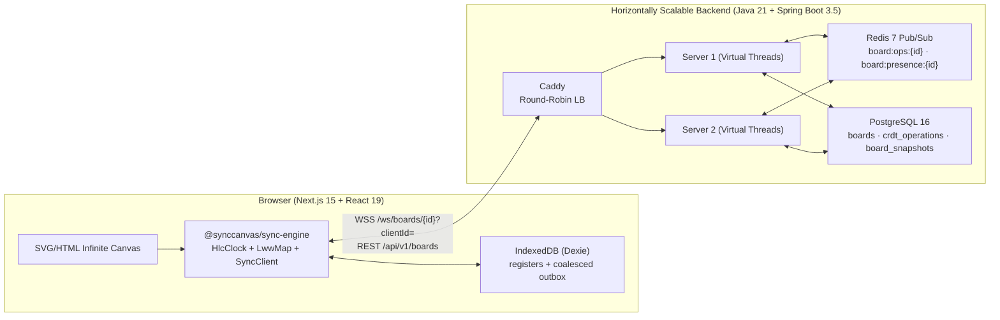
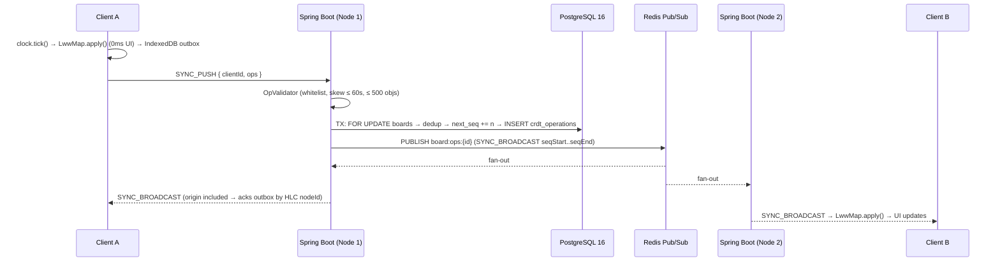

# SyncCanvas

**An offline-first, real-time collaborative whiteboard powered by a custom field-level LWW-Map CRDT and Hybrid Logical Clocks (HLC), proven bit-for-bit identical across TypeScript and Java.**

- Zero third-party CRDT libraries (no Yjs, no Automerge) — every line of `HlcClock`, `LwwMap`, coalesced outbox, gap-detection, and per-board gap-free sequencing is custom-built and verified with shared RFC 8785 JCS SHA-256 test vectors.
- Built-in **Split-Screen Recruiter Playground** (`User A` + `User B` side-by-side) with **Kill Network** toggles, a 1-click **Conflict Demo**, latency simulator, and a live **CRDT Merge Inspector**.

---

## Try It in 30 Seconds

```bash
pnpm install
pnpm --filter web dev
```

Open `http://localhost:3000` — if the backend isn't running, the playground automatically starts in **Local Simulation Mode** using the exact same `SyncClient`, `LwwMap`, and `HlcClock` over an in-browser loopback server. Click **⚡ Run Conflict Demo** to watch User A move a shape offline while User B recolors it online, then converge with identical SHA-256 state hashes on reconnect.

To run the full multi-node backend (`2× Spring Boot 3.5 + Redis 7 + PostgreSQL 16 + Caddy`):

```bash
docker compose --profile multinode up -d --build
pnpm --filter web dev
```

---

## Architecture



### Data Flow (Push → Gap-Free Sequence → Fan-Out → Ack)



---

## Why Field-Level LWW-Map?

Object-level Last-Write-Wins would silently drop either User A's drag or User B's recolor when both edit the same shape concurrently. SyncCanvas decomposes every object into independent `(objectId, field)` LWW-Registers stamped with a totally ordered Hybrid Logical Clock (`{13-digit-ms}:{5-digit-counter}:{nodeId}`):

| Replica          | Offline / Concurrent Edit | Register Written                    | Result After Merge |
| ---------------- | ------------------------- | ----------------------------------- | ------------------ |
| User A (offline) | Moves blue rect right     | `(obj_1, x) = 320 @ hlc_a`          | **Survives**       |
| User B (online)  | Recolors same rect green  | `(obj_1, fill) = "#dcfce7" @ hlc_b` | **Survives**       |

Because `LwwMap.apply(op)` is **commutative, associative, and idempotent**, every replica converges to the exact same state hash regardless of message order, duplicates, or network partitions.

---

## Key Design Decisions

| Decision                   | Choice                                                | Why                                                                                                                                              |
| -------------------------- | ----------------------------------------------------- | ------------------------------------------------------------------------------------------------------------------------------------------------ |
| **CRDT model**             | Field-level LWW-Map + HLC                             | Independent fields merge without conflict; delete-wins tombstones (`deleted = true`); simple, deterministic, auditable.                          |
| **Cross-language parity**  | RFC 8785 JCS + SHA-256                                | Removes JS `420` vs Java `420.0` formatting differences; 29 golden vectors in `spec/vectors/` run in both Vitest and JUnit 5.                    |
| **Sequencing**             | Per-board `FOR UPDATE` + `next_seq += n`              | Guarantees gap-free `serverSeq` matching commit order without cross-board `BIGSERIAL` contention or commit-order skew.                           |
| **Origin ack**             | Origin-included `SYNC_BROADCAST`                      | Single delivery path; clients ack outbox entries by matching HLC `nodeId` (`originClientId` is informational only).                              |
| **Recovery**               | Gap buffering + `SYNC_PULL` + `SNAPSHOT_REQUIRED`     | Handles best-effort Redis Pub/Sub drops and compacted op logs; snapshot recovery **merges** (never replaces) to preserve unsynced offline edits. |
| **Server-only skew guard** | Reject on `SYNC_PUSH`, never drop on `SYNC_BROADCAST` | Prevents replicas with drifting local wall clocks from diverging on already-accepted server ops.                                                 |

---

## Correctness & Verification

- **Cross-language golden vectors:** 14 HLC vectors + 15 LWW-Map merge vectors with verified RFC 8785 JCS SHA-256 hashes ([spec/vectors/](spec/vectors/README.md)) passing identically in TypeScript (`Vitest`) and Java (`JUnit 5`).
- **Property-based convergence:** 5-replica chaos simulator (`fast-check` in TS, `jqwik` in Java) exercising ≥ 10,000 ops with ±5s clock skew, drops, duplicates, reorderings, and partitions.
- **Database concurrency IT:** 8 threads × 500 ops on the same board asserting exact `1..4000` gap-free sequences ([OpLogRepositoryTest.java](server/src/test/java/com/synccanvas/persistence/OpLogRepositoryTest.java)).
- **Multi-node Redis chaos IT:** 6 headless clients split across `server1` and `server2` with mid-run `docker compose restart redis` ([e2e/multinode/chaos.mjs](e2e/multinode/chaos.mjs)).
- **Load & render benchmarks:** k6 1,000-VU WebSocket script ([loadtest/ws-load.js](loadtest/ws-load.js)) and `/bench` 1,000-object rAF harness. See [loadtest/RESULTS.md](loadtest/RESULTS.md).

---

## Known Limitations (v1)

- **Text editing:** LWW at the whole-string register level (no character-level RGA/Fugue CRDT).
- **Tombstone GC:** Deleted objects keep `deleted = true` tombstones for the board's lifetime (bounded by the 500-object cap and 24h demo TTL).
- **Presence:** Best-effort ephemeral cursors over Redis Pub/Sub (never persisted).

---

## Local Development & Verification

```bash
# TypeScript (sync-engine + Next.js web)
pnpm install
pnpm format:check && pnpm -r lint && pnpm -r typecheck && pnpm -r test
pnpm --filter web build

# Java 21 / Spring Boot 3.5 backend (start Docker Desktop for Testcontainers ITs)
cd server && ./gradlew check --rerun-tasks

# Full local multi-node stack
docker compose --profile multinode up -d --build
```

See [docs/ARCHITECTURE.md](docs/ARCHITECTURE.md) for a deep dive into the protocol and internals, and [docs/DEPLOY.md](docs/DEPLOY.md) for production deployment.
